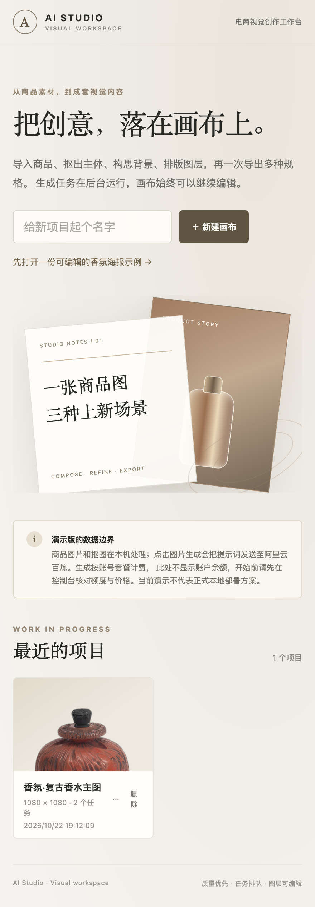
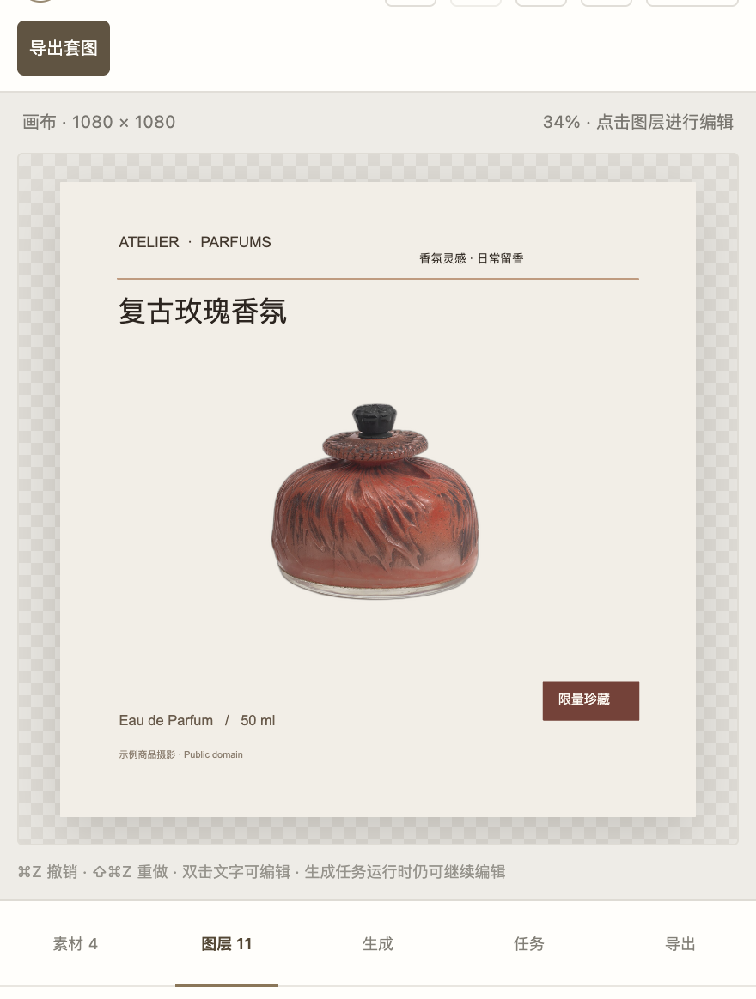
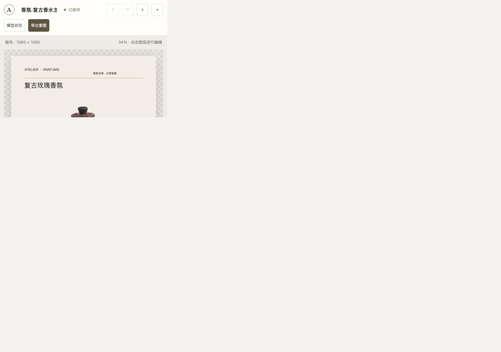
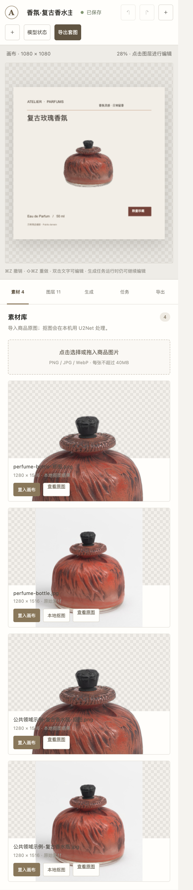

# 交互说明

## 1. 页面结构与交互原则

首页负责进入项目；编辑器以画布为中心，右侧面板包含「素材、图层、生成、任务、导出」；「模型状态」从编辑器顶部打开。操作结果应先反馈在所属面板或状态提示中，不用模型结果自动覆盖用户的画布内容。

> **原型边界：** 页面和主要交互已可演示，但目标方案要求所有推理本地完成。当前 U2Net 抠图在本机运行；文生图连接云端百炼，与产品目标不一致。下文分别标注“当前可操作”和“目标设计/未实现”。

## 2. 首页

- **用户操作：** 输入项目名后点「新建画布」，或点「先打开一份可编辑的香氛海报示例」。
- **系统反馈：** 项目进入最近项目列表；项目卡片提供打开入口和基本信息。
- **失败/边界：** 项目读取失败应显示错误而非持续加载。直接访问项目链接和刷新已做过浏览器验证。
- **隐私说明：** 当前演示页面说明提示词会发送给百炼；不要把它宣传成全本地推理。

## 3. 画布编辑器

- **用户操作：** 点击画布对象或图层列表，调整位置、大小、旋转、顺序、显示状态、透明度及文字；顶部支持撤销/重做。
- **系统反馈：** 画布即时预览，保存状态显示「已保存」或保存中/错误提示。页面刷新后从已保存数据恢复。
- **失败/恢复：** 保存失败显示错误并提供重试；恢复优先使用最近有效的快照/本机草稿。测试未覆盖断电、磁盘故障等灾难场景。
- **导出边界：** 导出使用画布尺寸与构图，不包含选中框和变换控制点。

## 4. 素材面板

- **用户操作：** 点击导入区域或拖入 PNG/JPG/WebP 商品图片；点击「本地抠图」后等待任务完成；检查原图和抠图结果，再点「置入画布」。
- **系统反馈：** 素材卡片展示原图/抠图类型、名称和尺寸；任务中心展示排队与运行状态。完成后抠图结果作为独立素材保存。
- **失败状态：** 不支持的类型、文件过大或处理错误应显示具体错误；原图保留，不因抠图失败而覆盖。
- **已验证样例：** 浏览器导入公共领域香水瓶实物照片并运行本地 U2Net，得到抠图素材。它不是用户自己的口红/在售商品，也不足以代表多品类质量。
- 实际透明背景结果：[U2Net 香水瓶抠图 PNG](./assets/u2net-cutout.png)。

## 5. 生成面板

- **当前可见操作：** 填写背景描述、选择生成张数，面板要求先核对额度与价格并确认后才可提交。
- **实际执行位置：** 当前文生图走阿里云百炼，提示词会发到云端；最近一次功能检查未提交生成。即使用户确认费用，这也只是原型功能，**不是目标产品的本地推理能力**。
- **成功目标交互（未实现本地生成）：** 新任务进入队列；完成候选显示在结果区，用户预览并选择「置入画布」后才成为图层。任务不得直接替换画布。
- **失败目标反馈（未验证生成模型）：** 显示失败原因和重试入口；本地模型未就绪或资源不足时应明确阻止，不调用云端兜底。
- **明确不支持：** 当前原型没有真实图生图、局部重绘或 ControlNet 背景控制。

## 6. 任务中心

- **用户操作：** 查看队列位置/进度；对排队或运行任务取消；对失败任务手动重试；成功结果由用户单独置入画布。
- **状态反馈：** `queued` 排队、`running` 运行、`succeeded` 完成、`failed` 失败、`cancelled` 本地取消、`interrupted` 中断/远端状态待确认。
- **失败重试：** 重试创建新任务，不改写旧记录。云端中断后必须先核实远端状态，避免重复生成/扣费；不会自动重提。
- **本地取消：** 当前本地任务请求取消后，在下一个进度回调停止并丢弃结果；不保证计算在点击瞬间终止。
- **云端停止等待：** 客户端停止等待不能保证服务商停止计算；远端结果或费用可能未知，任务标记为待确认，不自动重试。
- **本轮验证边界：** 自动化覆盖了本地/云端状态语义。浏览器里本地 U2Net 任务很快完成，未能在完成前验证点击取消，因此不把浏览器取消写成已通过。

## 7. 导出面板

- **用户操作：** 选择 PNG（保留透明背景）或 JPEG（白底），点「导出当前画布」，再下载各尺寸成品与 CSV 清单。
- **系统反馈：** 导出 800×800、750×1000、1080×1080 的画布合成图；提供下载链接和项目目录信息。
- **失败状态：** 面板显示导出错误；已验证下载入口和输出尺寸。透明 PNG 原像素与 JPEG 白底还由自动化测试覆盖。

## 8. 模型状态页

- **用户操作：** 从编辑器顶部点「模型状态」查看设备、当前演示模型、本地目标模型及评估维度。
- **系统反馈：** 页面标出 U2Net 本地可用、百炼文生图未核实额度，以及 SDXL/ControlNet、BiRefNet 权重未下载/未实测；不显示 API 密钥。
- **目标设计/未实现：** 本地模型就绪状态、授权状态和资源状态应由设备本地检测；未就绪时明确提示，不以云服务替代。

## 9. 评审演示路径（约 3–5 分钟）

1. 打开首页，说明目标方案要求全本地推理，并指出当前文生图是原型偏差。
2. 打开香氛海报示例，在「素材」确认真实商品照片和 U2Net 抠图结果。
3. 在画布调整一个文字图层并查看「已保存」；刷新项目页，确认图层恢复。
4. 打开「任务」展示本地抠图任务状态；说明云端任务中断不自动重提。不要为演示而创建云端生成任务。
5. 打开「导出」，导出多尺寸成品并从下载入口查看。
6. 打开「模型状态」，收尾说明 SDXL 本地生成方案尚未部署，因此当前交互原型不能证明全本地推理目标已实现。

